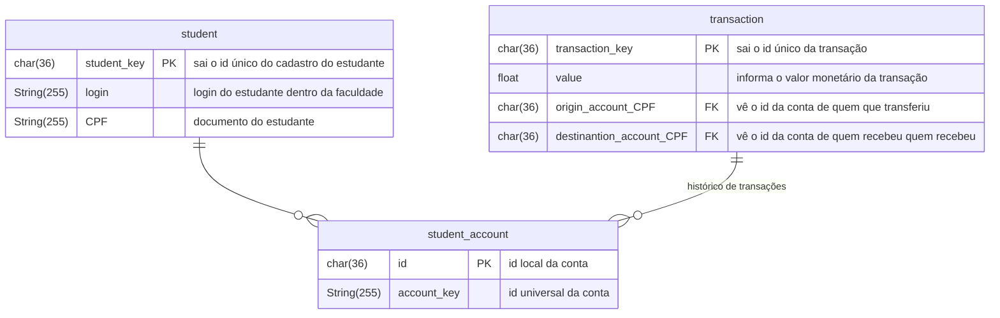
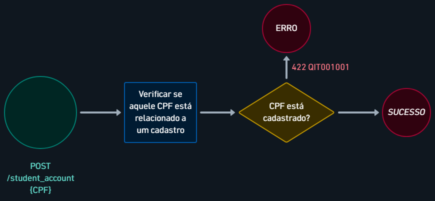
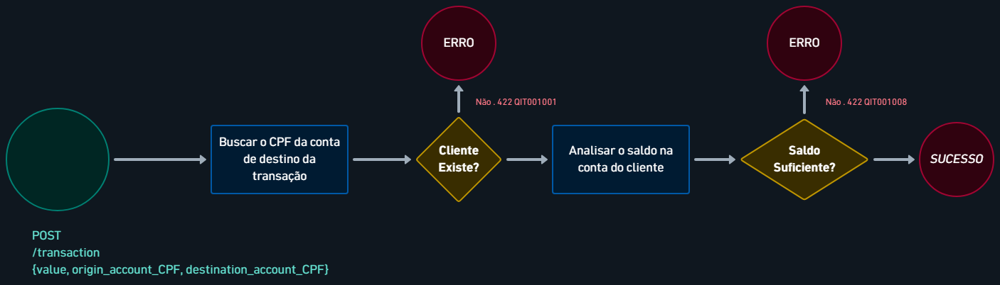
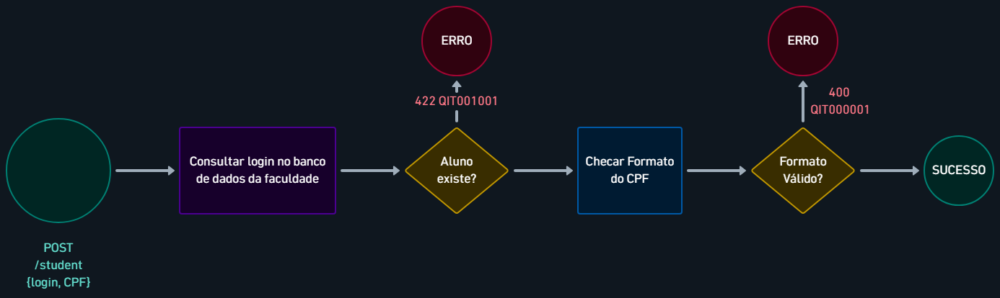

# RFC — Construção de um Sistema Bancário

| | |
|---|---|
| **Time** | Carlos Neto · Henrique Segala · Pedro Peixoto |
| **Data** | 28/09/2026 |
| **Versão** | 1.0 |

> **Como usar este modelo** *(apague este bloco antes de entregar)*
>
> - *Cada seção abre com um bloco em itálico: o que escrever, as perguntas a responder e o tamanho
>   esperado. **Apague a orientação** e escreva no lugar dela. Não acrescente seções.*
> - *O destaque **Principal desafio** aparece **na seção onde o desafio mora** — se a parte difícil
>   é o modelo de dados, ele fica em Banco de Dados; se é concorrência ou ordem de passos, fica em
>   Fluxos. Normalmente há **um**; se houver dois de peso igual, cada um fica na sua seção.*
> - *Neste modelo o destaque aparece uma única vez, em Fluxos, como exemplo de posicionamento.*
> - *Alvo de tamanho: 2 a 4 páginas. O repositório-base (`bootcamp-base-api`, Python + FastAPI +
>   PostgreSQL + Docker) é o ponto de partida; o desenho é do seu time.*

## Contextualização

### Entendendo o problema

> *O que o sistema precisa fazer e por que isso é difícil. Responda:*
>
> - *Que operações o sistema oferece e quem as usa?*
> - *Que garantia ele precisa dar em cima do dinheiro? O que acontece se der errado — saldo
>   divergente, transação duplicada, extrato que não reconstrói o saldo, dado que some?*
> - *O que está **fora do escopo** desta entrega?*
>
> *5 a 10 linhas. Não entra aqui: solução, rota, tabela, nome de biblioteca.*

O sistema bancário universitário tem como usuário o estudante. Ele pode se cadastrar, criar sua conta, depositar dinheiro para essa conta, transferir dinheiro sob-tarifa para outros(as) estudantes ou entidades do ecossistema universitário e consultar seu extrato. O sistema deve garantir o seguinte:

- Cadastro: o cadastro só pode ser efetuado por estudantes, os quais só pode se cadastrar uma única vez. Se falhar, passará a existir 2 cadastros iguais, o que poderá ocasionar um conflito nas transações.
- Transações: Uma transação só pode acontecer de forma única com o devido saldo. Se falhar, o cliente ficará com um saldo incoerente com os seus gastos
- Idempotência: Se 2 transações ocorrem ao mesmo tempo, o sistema deve efetuar primeiro uma, depois a outra. Se falhar, algum cliente terá um saldo incoerente
- Atomicidade: A operação deve ser concluída integralmente ou não produzir nenhuma alteração. Se falhar, poderá gerar "alterações parciais" que podem quebrar o banco de dados.
- Extrato: as informações de cada transação devem estar armazenadas para o usuário poder visualizar. Se falhar, o usuário não terá o extrato disponível

Fora do escopo da entrega: validação da origem externa dos depósitos, transação se originando nas contas institucionais, consulta do extrato por contas institucionais 

### Explicando a solução de forma macro

> *A ideia em um parágrafo: quais são as peças e como elas se encaixam para dar a garantia da seção
> anterior. Um desenho de caixas ajuda, se você tiver um.*
>
> *Depois, **o que foi considerado e descartado** — uma linha por alternativa, com o preço de cada
> uma. É o que a R7 cobra: as decisões tomadas **e** as descartadas. Forma sugerida:*
>
> - *`<alternativa descartada>` — descartada porque `<o que ela custava>`. Ganharia se
>   `<cenário em que ela seria a melhor escolha>`.*
>
> *1 parágrafo + 2 a 4 alternativas. Não entra aqui: rota, tabela, passo a passo.*

São 3 entidades utilizadas - `students` , `students_account` e `transaction`. O estudante se cadastra na entidade `students` **(número de matrícula como identificador)** utilizando informações pessoais, que serão utilizadas para checar se aquele cadastro é válido. O estudante cadastrado também poderá criar a sua conta bancária verificando suas informações pessoais. Com sua conta em mãos, o estudante poderá efetuar transações, as quais sempre serão armazenadas na entidade `transaction` **(ter uma opção de depósito de conta externa, senão o cara não tem dinheiro)**. Essas transações só deverão acontecer caso o estudante tenha saldo o suficiente e a conta de destino for existente. Caso queira checar seu extrato, uma varredura em `transaction` **(Considerar ideia de árvore)** encontrará todas as transações que estão em seu nome.  Alternativas descartadas: 

- **Tabela separada de movimentações (`account_movement`)**: Todas informações que essa entidade representa podem ser facilmente colocado na própria entidade de transaction . A criação só traria maior complexidade. Seria útil caso outras “mecânicas” de transação fossem adicionadas (cashback, reembolso, pagamento parcelado…)

## Implementação

### Rotas

> *Uma linha por rota, na tabela abaixo. Regras:*
>
> - *Status de erro **explícitos** — `400`, `404`, `409`, `422`, e em que situação cada um sai. Não
>   basta escrever "erro".*
> - *Diga se a rota é **idempotente** e, se for, o que a torna idempotente (qual campo, qual
>   restrição). Repetir a mesma requisição é tema da Aula 2.*
> - *Em "Entrada", só os campos que importam para a decisão — não é o schema completo.*
>
> *Não entra aqui: código.*

| Método | Caminho | O que faz | Entrada (campos que importam) | Saídas (status e quando) |
|---|---|---|---|---|
| `POST` | `/student` | cadastra um estudante |`login`, `CPF`|`201` com o `transaction_key`, `400` `QIT000001` corpo fora do formato, `422` `QIT001001` login do estudante não existe|
|`POST`|`/student_account`| cria a conta bancária de um estudante |`CPF`|`201`, `404` `QIT001001` cadastro de estudante nâo encontrado|
|`GET`|`/health_check`|Diz se o servidor está de pé||`204`|
| `GET` | `/student/{student_key}` | devolve um estudante | `student_key` no caminho | `200` …; `404` … |
|`POST`|`transaction/`|Efetua uma transação de valor `value`|`value`, `origin_account_CPF`, `destination_account_CPF`|`201` com o `transaction_key`, `400` `QIT000001` corpo fora do formato,`422` `QIT001001` cpf do destinatário não está vinculado a uma conta cadastrada, `422` `QIT001008` valor de saldo insuficiente |
| … | … | … | … | … |

### Banco de Dados (Somente diagrama)

> *Só o diagrama. Entidades, chaves, relacionamentos e os campos que importam para o desafio: o que
> garante unicidade, o que guarda estado, o que registra quando aconteceu, o identificador que sai
> na resposta. **Sem prosa nesta seção** — se o principal desafio do seu desenho é o modelo de
> dados, o único texto aqui é o destaque "Principal desafio". Substitua o esqueleto abaixo pelo seu
> diagrama.*

### Fluxos

> *Para cada operação principal, dois caminhos:*
>
> - *o **caminho feliz**, em passos numerados ou diagrama de sequência;*
> - ***pelo menos um caminho de falha** — o mais provável ou o mais caro.*
>
> *Onde houver transação, concorrência ou retentativa, o passo diz o que acontece: o que é travado,
> o que é desfeito, o que o cliente recebe de volta. Não entra aqui: repetir o que a tabela de rotas
> já disse.*

**\<operação\> — caminho feliz**

1. …
2. …

**\<operação\> — falha: \<qual\>**

1. …
2. …

> ## Principal desafio
>
> *Mova este bloco para a seção onde o seu desafio está; apague daqui se não for aqui.*
>
> - **Qual é:** \<a parte do problema que resiste\>
> - **Por que é difícil:** \<o que entra em tensão, ou o cenário que quebra a solução óbvia\>
> - **Como o desenho resolve:** \<o mecanismo concreto, não a intenção\>
