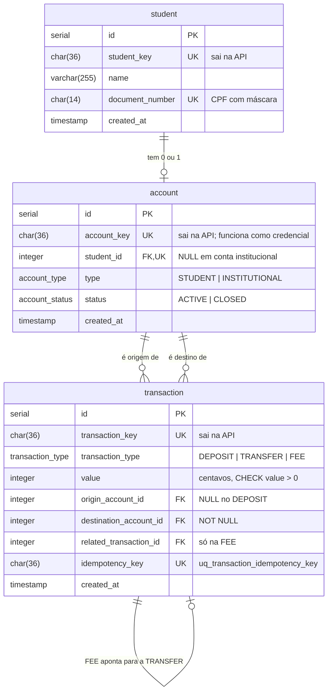

# Material de apoio para a RFC

Estado do repositório em **12/10/2026**, na `main` com o commit `eed2c81` ("close e extrato, os testes agora só usam as rotas"). Tudo aqui foi conferido no código e nos testes. Nada vem de memória ou de rascunho.

As seções seguem a ordem do `bootcamp-rfc-modelo.md`, para facilitar copiar cada parte para o lugar certo. No fim há uma lista do que o rascunho atual da RFC (`bootcamp-rfc-modelo.md`) diz e que **não bate mais** com o código.

---

## 1. Contextualização

### 1.1 O problema

Serviço bancário universitário, só de backend. O único usuário é o **estudante**: ele se cadastra, cria uma conta, deposita, transfere para outros estudantes ou para instituições da universidade (cantina, estacionamento), consulta saldo e extrato e encerra a conta. Todo o dinheiro circula dentro do ecossistema: depois de entrar por depósito, ele não sai, porque não existe saque.

Garantias que o sistema precisa dar:
- **Sem saldo negativo:** uma transferência só acontece se a origem tiver saldo para o valor mais a tarifa, inclusive quando várias requisições chegam ao mesmo tempo.
- **Sem cobrança duplicada:** a mesma requisição repetida (retry do cliente) não move o dinheiro duas vezes.
- **Atomicidade:** a transferência e a tarifa são gravadas juntas, ou nenhuma das duas é gravada.
- **Saldo reconstruível:** o saldo é sempre a soma das movimentações. Não existe um saldo guardado que possa divergir do histórico.
- **Cadastro único e verificado:** um CPF só se cadastra uma vez, e só se a universidade confirmar que é de um aluno. Cada estudante tem no máximo uma conta.
- **Nenhum dinheiro preso:** uma conta só é encerrada com saldo zero, e nenhum depósito ou transferência entra numa conta que está sendo encerrada.

Se der errado: saldo negativo, transferência duplicada, tarifa cobrada sem transferência (ou o contrário), ou uma pessoa que não é aluna dentro do sistema.

**Fora do escopo desta versão:** autenticação e autorização do estudante, saque, integração real com PIX, cartão ou banco (o depósito representa dinheiro já validado fora), transferência iniciada por instituição, criação ou encerramento de conta institucional pela API, paginação por cursor e saldo linha a linha no extrato.

### 1.2 A solução de forma macro

Três tabelas: `student`, `account` e `transaction`. O estudante é verificado junto ao servidor da universidade e só então gravado. Cada estudante tem no máximo uma conta `STUDENT`. As contas `INSTITUTIONAL` (universidade, cantina e estacionamento) são criadas por seed e só recebem dinheiro. **Toda movimentação é uma linha em `transaction`**, de um dos três tipos: `DEPOSIT`, `TRANSFER` ou `FEE`. O saldo não é armazenado: ele é calculado somando as linhas em que a conta é destino e subtraindo as linhas em que ela é origem. Cada transferência gera também uma `FEE` de R$ 2,00 para a conta da universidade, que funciona como conta de tarifas. O estudante pode encerrar a própria conta quando o saldo dela for zero, e a partir daí a conta não movimenta nem pode ser consultada.

Concorrência e repetição são tratadas no banco: **lock pessimista** (`SELECT ... FOR UPDATE`) nas contas de estudante envolvidas, em ordem fixa de `id`, e uma **chave de idempotência** (`Idempotency-Key`) por operação, protegida por uma restrição `UNIQUE`.

### 1.3 Alternativas descartadas

- **Guardar o saldo numa coluna da conta:** descartada porque o saldo pode divergir do histórico de transações, e cada movimentação teria que atualizar duas coisas. Ganharia em leitura muito frequente de saldo, com milhões de transações por conta.
- **Tabela separada para movimentações ou para tarifas:** descartada porque depósito, transferência e tarifa têm a mesma forma (valor, origem e destino). Uma tabela só simplifica o saldo e o extrato. Ganharia se surgissem mecânicas com dados próprios, como cashback, estorno ou parcelamento.
- **Carregar os estudantes antes, com `student_key` nula:** descartada porque exigiria uma importação externa e deixaria linhas "pela metade" no banco. O estudante só entra pelo `POST /student`, depois de verificado.
- **Tabelas de domínio para tipo e status (como no `base-service`):** descartadas em favor de `ENUM` do Postgres, para o modelo ficar com exatamente três tabelas. Ganhariam se os valores precisassem mudar sem alterar o esquema.
- **`Idempotency-Key` no corpo da requisição:** descartada em favor do header, que é a convenção de APIs de pagamento. O preço é uma validação à parte, porque o `SchemaHandler` do `base-service` só valida corpo e query string.
- **Checar duplicidade (CPF, conta, chave) com um `SELECT` antes do `INSERT`:** descartada porque duas requisições simultâneas passam juntas pela checagem. Quem decide é a restrição `UNIQUE` no `INSERT`.

---

## 2. Rotas

Todas as rotas, exceto `/` e `/health_check`, exigem o header **`INTERNAL-TOKEN`**, herdado do `base-service`. Sem ele, a resposta é `403 QIT000002`, antes de qualquer validação da rota. Ele **não é autenticação de estudante**: todos os clientes usam o mesmo valor.

Valores em **centavos**. `value` é inteiro, de 1 a **200.000.000** (R$ 2.000.000,00), por operação.

| Método | Caminho | O que faz | Entrada | Saídas | Idempotente? |
|---|---|---|---|---|---|
| `GET` | `/health_check` | Diz se o processo está de pé. Não consulta o banco | — | `204` | Sim (leitura) |
| `POST` | `/student` | Cadastra o estudante depois de a universidade confirmar o CPF | Corpo: `name` (1 a 255 caracteres), `document_number` (CPF com máscara `000.000.000-00`) | `201` com `student_key`; `400 QIT000001` corpo fora do formato; `422 QIT001003` a universidade diz que não é aluno; `503 QIT001014` universidade fora do ar, timeout ou resposta inesperada; `409 QIT001004` CPF já cadastrado | Não. Repetir dá `409` |
| `POST` | `/account` | Cria a conta do estudante. Sempre `STUDENT` e `ACTIVE` | Corpo: `student_key` (UUID) | `201` com `account_key` e `status`; `400 QIT000001` corpo fora do formato; `404 QIT001001` estudante não existe; `409 QIT001009` estudante já tem conta | Não. Repetir dá `409` |
| `POST` | `/deposit` | Deposita na conta de um estudante | Corpo: `account_key` (UUID), `value`. Header: `Idempotency-Key` (UUID) | `201` com `transaction_key`; `400 QIT000001` corpo ou header fora do formato; `404 QIT001001` conta não existe; `409 QIT001011` conta institucional; `409 QIT001002` conta `CLOSED`; `409 QIT001010` chave já usada em outra operação | **Sim**, pela `Idempotency-Key` |
| `POST` | `/transfer` | Transfere de um estudante para outro estudante ou para uma instituição, cobrando a tarifa | Corpo: `origin_account_key`, `destination_account_key` (UUIDs), `value`. Header: `Idempotency-Key` (UUID) | `201` com `transaction_key` da `TRANSFER`; `400 QIT000001` corpo ou header fora do formato; `409 QIT001013` origem e destino iguais; `409 QIT001015` destino é a conta de tarifas; `404 QIT001001` alguma conta não existe; `409 QIT001012` origem institucional; `409 QIT001002` origem ou destino `CLOSED`; `409 QIT001008` saldo menor que `value` + 200; `409 QIT001010` chave já usada em outra operação | **Sim**, pela `Idempotency-Key` |
| `GET` | `/account/{account_key}` | Conta com saldo calculado | `account_key` no caminho | `200` com `account_key`, `type`, `status`, `balance` e `created_at` (ISO 8601 com `+00:00`); `400 QIT000001` chave fora do formato; `404 QIT001001` conta não existe; `409 QIT001002` conta `CLOSED` | Sim (leitura) |
| `GET` | `/account/{account_key}/transactions` | Extrato paginado, do mais recente para o mais antigo | Caminho: `account_key`. Query: `page` (inteiro ≥ 0, padrão 0), `limit` (inteiro de 1 a 100, padrão 10) | `200` com `data`, `limit`, `page` e `is_last_page`; `400 QIT000001` chave ou parâmetro fora do formato, ou parâmetro desconhecido; `404 QIT001001` conta não existe; `409 QIT001002` conta `CLOSED` | Sim (leitura) |
| `POST` | `/account/{account_key}/close` | Encerra a conta de um estudante | `account_key` no caminho. Sem corpo | `200` com `account_key` e `status = CLOSED`; `400 QIT000001` chave fora do formato; `404 QIT001001` conta não existe; `409 QIT001017` conta institucional; `409 QIT001002` conta já `CLOSED`; `409 QIT001016` saldo diferente de zero | Não. Repetir dá `409 QIT001002` |

**Extrato:** cada linha de `data` traz `transaction_key`, `transaction_type`, `amount`, `counterparty_type`, `counterparty_name`, `counterparty_account_key` e `created_at`.
- `amount` é relativo à conta consultada: `+value` quando ela é o destino e `-value` quando é a origem. Não é o saldo.
- A outra ponta da movimentação:

| Outra ponta | `counterparty_type` | `counterparty_name` | `counterparty_account_key` |
|---|---|---|---|
| Estudante | `STUDENT` | nome do estudante | `null` (a chave de um estudante é credencial e não pode aparecer no extrato de outro) |
| Instituição | `INSTITUTIONAL` | `null` | chave da instituição |
| Nenhuma (depósito) | `null` | `null` | `null` |

- A ordem é `created_at DESC, id DESC`. Como a `TRANSFER` e a `FEE` são gravadas juntas e têm o mesmo `created_at`, o desempate por `id` coloca a `FEE` logo acima da `TRANSFER`.
- A paginação busca `limit + 1` linhas para saber se há próxima página, sem contar o total. Conta sem movimentação, ou página além da última, devolve `200` com `data` vazio e `is_last_page = true`.

**Como a idempotência funciona em `/deposit` e `/transfer`:**
- Mesma `Idempotency-Key` com **os mesmos dados** (mesmo tipo, mesmo `value` e mesmas contas): retry. A resposta é `201` com a `transaction_key` **original**, e nada é gravado de novo.
- Mesma chave com **dados diferentes**, ou uma chave que já foi usada em outro tipo de operação: `409 QIT001010`.
- **Só operações bem-sucedidas consomem a chave.** Uma requisição recusada não grava nada, e a mesma chave pode ser usada depois.
- O retry devolve o original **mesmo que a conta tenha sido fechada depois**, porque a checagem de idempotência vem antes da checagem de `CLOSED`.
- A garantia final é a restrição `UNIQUE` na coluna `idempotency_key` (nome: `uq_transaction_idempotency_key`).

---

## 3. Banco de dados

PostgreSQL 16, criado pelo `database/database.sql`.



**Restrições que sustentam as regras:**

| Restrição | Garante |
|---|---|
| `UNIQUE(document_number)` (`student_document_number_key`) | Um CPF, um cadastro. É a fonte do `409 QIT001004` |
| `UNIQUE(student_id)` (`account_student_id_key`) | Um estudante, uma conta. É a fonte do `409 QIT001009`. No Postgres, o `UNIQUE` aceita vários `NULL`, então várias contas institucionais convivem |
| `CHECK` em `account` | `STUDENT` sempre tem `student_id`; `INSTITUTIONAL` nunca tem |
| `UNIQUE(idempotency_key)` (`uq_transaction_idempotency_key`) | A mesma operação não é gravada duas vezes, nem sob concorrência. É a fonte do `409 QIT001010` |
| `CHECK (value > 0)` | Nenhuma movimentação zerada ou negativa |
| `destination_account_id NOT NULL` | Toda movimentação tem destino |
| Índices em `origin_account_id` e `destination_account_id` | Saldo e extrato, que filtram por essas colunas |

**Seed (contas institucionais, chaves fixas):**

| Conta | `account_key` | Papel |
|---|---|---|
| Universidade | `26ccf53d-7a91-41bf-acc2-09a93743f423` | **Conta de tarifas.** Só recebe `FEE`. Configurada pela variável `FEE_ACCOUNT_KEY` |
| Cantina | `06d8b86d-6d68-402d-9c8a-e089230f16ce` | Recebe transferências |
| Estacionamento | `e2f33a85-efb7-4bc5-afde-4ffe5229f7f3` | Recebe transferências |

**Saldo**, calculado sempre que é necessário:
```sql
SELECT COALESCE(SUM(CASE WHEN destination_account_id = :id THEN value END), 0)
     - COALESCE(SUM(CASE WHEN origin_account_id = :id THEN value END), 0)
FROM transaction
WHERE destination_account_id = :id OR origin_account_id = :id;
```
`DEPOSIT` soma no destino. `TRANSFER` subtrai na origem e soma no destino. `FEE` subtrai 200 na origem e soma 200 na universidade. A soma de `INTEGER` no Postgres devolve `BIGINT`, então o saldo pode passar do limite de uma coluna `INTEGER`.

---

## 4. Fluxos

O `ROLLBACK` não aparece nos passos: qualquer erro levantado dentro de uma transação faz o `session_manager` do `base-service` desfazer tudo. O `COMMIT` é sempre o último passo do controller.

### 4.1 `POST /student`

**Caminho feliz**
1. O schema valida o corpo.
2. A API consulta `GET /student/{cpf}` no servidor da universidade, **antes** de tocar no banco e **fora** de qualquer transação, com timeout de 5 segundos (`UNIVERSITY_API_TIMEOUT`).
3. A universidade responde `200`.
4. A API gera a `student_key` (UUID) e faz o `INSERT`.
5. `COMMIT` e `201` com a `student_key`.

**Falha: universidade fora do ar ou lenta**
1. A chamada estoura o timeout, ou a conexão cai, ou a universidade responde um status diferente de `200` e `404`.
2. A API responde `503 QIT001014`, e nada é gravado. O cliente pode tentar de novo depois.

**Falha: CPF já cadastrado**
1. A universidade confirma o aluno.
2. O `INSERT` viola o `UNIQUE(document_number)`.
3. A API responde `409 QIT001004`. A consulta à universidade vem antes de propósito: quem não é aluno recebe `422`, e não descobre se um CPF está cadastrado.

### 4.2 `POST /account`

**Caminho feliz**
1. O schema valida o corpo, inclusive o formato UUID da `student_key`.
2. A API busca o estudante pela `student_key`.
3. A API gera a `account_key` e faz o `INSERT` com `type = STUDENT` e `status = ACTIVE`.
4. `COMMIT` e `201` com `account_key` e `status`.

**Falha: estudante já tem conta**
1. O `INSERT` viola o `UNIQUE(student_id)`.
2. A API responde `409 QIT001009`. A chave da conta existente **não** é devolvida, porque chave perdida não é recuperável nesta versão.

### 4.3 `POST /deposit`

**Caminho feliz**
1. O schema valida o corpo, e o resource valida o header `Idempotency-Key` (presente e com formato UUID).
2. As chaves são convertidas para minúsculas.
3. A transação é aberta com isolamento `READ COMMITTED`.
4. A API busca a conta. Se ela não existir, a resposta é `404`. Se for institucional, `409 QIT001011`.
5. `SELECT ... FOR UPDATE` na conta. O `status` usado daqui em diante é o lido junto com o lock.
6. A API busca uma transação com a mesma `Idempotency-Key` e não encontra.
7. A conta não está `CLOSED`.
8. `INSERT` do `DEPOSIT`, sem origem e com destino na conta.
9. `COMMIT` e `201` com a `transaction_key`.

**Falha: retry**
1. No passo 6, a API encontra uma transação com a mesma chave, do tipo `DEPOSIT`, com o mesmo `value` e na mesma conta.
2. `COMMIT` sem gravar nada e `201` com a `transaction_key` original.

### 4.4 `POST /transfer`

**Caminho feliz**
1. O schema valida o corpo, e o resource valida o header `Idempotency-Key`.
2. As chaves são convertidas para minúsculas.
3. **Fora da transação:** se origem e destino forem iguais, a resposta é `409 QIT001013`. Se o destino for a conta de tarifas, `409 QIT001015`. As duas checagens só comparam valores da requisição.
4. A transação é aberta com isolamento `READ COMMITTED`.
5. Leitura simples (sem lock) da origem, do destino e da conta de tarifas, numa consulta só. Se a origem ou o destino não existirem, `404`. Se a conta de tarifas não existir, `500`, porque é um erro de configuração. Se a origem for institucional, `409 QIT001012`.
6. `SELECT ... FOR UPDATE` nas contas **de estudante** envolvidas, **em ordem crescente de `id`**. Contas institucionais não são travadas.
7. A API busca a `Idempotency-Key` e não encontra.
8. Nem a origem nem o destino estão `CLOSED`.
9. O saldo da origem, calculado depois do lock, é maior ou igual a `value` + 200.
10. `INSERT` da `TRANSFER`.
11. `INSERT` da `FEE`: 200 centavos, da origem para a universidade, com `related_transaction_id` igual ao `id` da `TRANSFER`.
12. `COMMIT` e `201` com a `transaction_key` da `TRANSFER`.

**Falha: saldo insuficiente**
1. No passo 9, o saldo é menor que `value` + 200.
2. `409 QIT001008`. Nada é gravado, a chave não é consumida e os locks são soltos.

**Falha: duas requisições com a mesma chave ao mesmo tempo, em contas diferentes**
1. Como o lock é por conta, uma requisição não espera a outra. As duas passam pelo passo 7 sem encontrar a chave.
2. A primeira grava a `TRANSFER`. O `INSERT` da segunda viola o `uq_transaction_idempotency_key`.
3. A API reconhece **essa** restrição e responde `409 QIT001010`. Qualquer outra violação vira `500`.

### 4.5 `GET /account/{account_key}`

**Caminho feliz**
1. O resource valida a `account_key` do caminho (formato UUID).
2. A chave é convertida para minúsculas, e a API busca a conta.
3. A conta não está `CLOSED`.
4. A API calcula o saldo e responde `200`. É só leitura: sem lock e sem escrita.

**Falha: conta encerrada**
1. A conta existe, mas está `CLOSED`.
2. `409 QIT001002`. Nenhum dado da conta é devolvido.

O saldo devolvido é uma fotografia do instante e não serve como checagem antes de transferir. Quem decide se há saldo é o `/transfer`, com lock.

### 4.6 `GET /account/{account_key}/transactions`

**Caminho feliz**
1. O decorator `validate_query_params` do `base-service` valida `page` e `limit` contra um JSON Schema, e o resource valida a `account_key`.
2. A API busca a conta (`404` se não existir, `409 QIT001002` se estiver `CLOSED`).
3. Uma consulta só traz as transações em que a conta é origem ou destino, já com o `amount` com sinal e com a outra ponta por `LEFT JOIN` em `account` e `student`, em `ORDER BY created_at DESC, id DESC`, com `LIMIT limit + 1` e `OFFSET page × limit`.
4. Se vieram mais de `limit` linhas, a extra é descartada e `is_last_page = false`. Senão, `is_last_page = true`.
5. O DTO monta cada linha: o nome só sai se a outra ponta for estudante, e a chave só sai se for instituição.
6. `200` com o envelope `data`, `limit`, `page` e `is_last_page`.

**Falha: página além da última**
1. O `OFFSET` passa do total de linhas.
2. `200` com `data` vazio e `is_last_page = true`. Não é erro.

### 4.7 `POST /account/{account_key}/close`

**Caminho feliz**
1. O resource valida a `account_key`.
2. A transação é aberta com isolamento `READ COMMITTED`.
3. A API busca a conta. Se não existir, `404`. Se for institucional, `409 QIT001017`. Essa checagem vem antes do lock, porque o `type` nunca muda.
4. `SELECT ... FOR UPDATE` na conta, o **mesmo lock** do `/deposit` e do `/transfer`.
5. A conta não está `CLOSED`.
6. O saldo, calculado **depois do lock**, é zero.
7. `UPDATE` do `status` para `CLOSED`, `COMMIT` e `200`.

**Falha: depósito e encerramento ao mesmo tempo**
1. As duas requisições disputam o lock da conta.
2. Se o encerramento trava primeiro, ele vê saldo zero e fecha. O depósito espera, lê o `status` atualizado junto com o lock e recebe `409 QIT001002`.
3. Se o depósito trava primeiro, ele grava. O encerramento espera, calcula o saldo depois do lock, vê o valor depositado e recebe `409 QIT001016`.
4. Em nenhuma ordem a conta termina fechada com dinheiro dentro.

> ## Principal desafio
>
> - **Qual é:** garantir que o saldo nunca fique negativo e que nenhuma operação aconteça duas vezes, com várias requisições simultâneas sobre as mesmas contas.
> - **Por que é difícil:** a solução óbvia ("ler o saldo, conferir, gravar") quebra com duas transferências simultâneas da mesma conta. As duas leem o mesmo saldo, as duas aprovam, e o saldo fica negativo. Travar as contas resolve isso, mas criaria deadlock em transferências cruzadas (A→B e B→A ao mesmo tempo). E o lock por conta não protege a idempotência quando a mesma chave chega em contas diferentes.
> - **Como o desenho resolve:**
>   - `SELECT ... FOR UPDATE` nas contas de estudante **antes** de calcular o saldo. A segunda requisição espera a primeira terminar e já enxerga a transação dela. O isolamento `READ COMMITTED` garante que essa leitura vê o commit da outra.
>   - Locks **sempre em ordem crescente de `id`**, o que elimina o deadlock nas transferências cruzadas.
>   - A idempotência é checada **depois** do lock (o retry na mesma conta espera e encontra a transação original) e **antes** de `CLOSED` e do saldo (o retry devolve o original mesmo se a situação da conta mudou).
>   - O `UNIQUE` na `idempotency_key` cobre o único caso que o lock não serializa: a mesma chave em contas diferentes.
>   - `TRANSFER` e `FEE` no mesmo `COMMIT`: ou as duas existem, ou nenhuma.

---

## 5. Códigos de erro

Cada código tem um único status e uma única causa. A API não sobe se dois erros usarem o mesmo código.

| Código | Status | Causa | Rotas |
|---|---|---|---|
| `QIT000001` | 400 | Corpo, header ou parâmetro fora do formato | Todas, exceto `/health_check` |
| `QIT000002` | 403 | Header `INTERNAL-TOKEN` ausente ou inválido | Todas, exceto `/` e `/health_check` |
| `QIT000404` | 404 | Rota inexistente (do `base-service`) | — |
| `QIT000405` | 405 | Método não permitido na rota (do `base-service`) | — |
| `QIT000500` | 500 | Erro inesperado | Todas |
| `QIT001001` | 404 | Estudante ou conta referenciado não existe | `/account`, `/deposit`, `/transfer`, `GET /account/{account_key}`, extrato, encerramento |
| `QIT001002` | 409 | Conta `CLOSED` | `/deposit`, `/transfer`, `GET /account/{account_key}`, extrato, encerramento |
| `QIT001003` | 422 | CPF não corresponde a um estudante da universidade | `/student` |
| `QIT001004` | 409 | CPF já cadastrado | `/student` |
| `QIT001008` | 409 | Saldo insuficiente para `value` mais a tarifa | `/transfer` |
| `QIT001009` | 409 | Estudante já possui conta | `/account` |
| `QIT001010` | 409 | `Idempotency-Key` usada em outra operação | `/deposit`, `/transfer` |
| `QIT001011` | 409 | A conta não aceita depósito (é institucional) | `/deposit` |
| `QIT001012` | 409 | A conta de origem não pode transferir (é institucional) | `/transfer` |
| `QIT001013` | 409 | Origem e destino são a mesma conta | `/transfer` |
| `QIT001014` | 503 | Verificação junto à universidade não pôde ser concluída | `/student` |
| `QIT001015` | 409 | A conta de destino não aceita transferência (é a conta de tarifas) | `/transfer` |
| `QIT001016` | 409 | A conta só pode ser encerrada com saldo zero | encerramento |
| `QIT001017` | 409 | Só contas de estudante podem ser encerradas | encerramento |

Formato de toda resposta de erro: `{"title", "description", "translation", "code"}`. As mensagens não incluem CPF, nome nem chaves.

---

## 6. Testes

**80 testes de integração, todos passando.** Eles chamam a API real (no Docker) **só por HTTP**: nenhum teste lê ou escreve no banco. Até a preparação dos dados (estudante, conta, saldo e encerramento) passa pelas rotas, pelo helper `ObjectGenerator`.

| Arquivo | Testes | O que cobrem |
|---|---|---|
| `test_healthcheck.py` | 6 | Rota raiz, health check, `403` sem token, `404` e `405` do framework |
| `student/test_student.py` | 9 | Corpo inválido (8 casos), sucesso, `422` não é aluno, `409` CPF duplicado, universidade consultada antes do `409`, `503` por queda de conexão, timeout e erro da universidade, e dois cadastros simultâneos do mesmo CPF. Depois de cada recusa, o teste cadastra o mesmo CPF de novo para provar que nada foi gravado |
| `account/test_account.py` | 5 | Corpo inválido, `404`, sucesso (tipo, status e saldo 0), `409` conta duplicada e duas criações simultâneas |
| `account/test_account_get.py` | 8 | Chave inválida, `404`, sucesso com exatamente os cinco campos, chave em maiúsculas, saldo zero, saldo depois de transferência e tarifa, conta `CLOSED` recusada e conta institucional |
| `account/test_account_transactions.py` | 12 | Parâmetros inválidos (7 casos), `404`, `CLOSED`, última página, página que não é a última, total múltiplo exato do `limit`, página além da última, conta vazia, padrões de `page` e `limit`, linha de depósito, transferência vista pelos dois lados (com a `FEE` logo acima e a privacidade da outra ponta) e transferência para instituição |
| `account/test_account_close.py` | 10 | Chave inválida, `404`, institucional, saldo de 1 centavo recusado, encerramento com saldo zero, depósito recusado depois do encerramento, encerrar duas vezes, encerrar depois de esvaziar por transferência, chave em maiúsculas e depósito e encerramento simultâneos |
| `deposit/test_deposit_create.py` | 11 | Corpo e header inválidos, `404`, institucional, `CLOSED`, sucesso sem tarifa, retry, chave com dados diferentes, retry depois de `CLOSED`, falha que não consome a chave e o teto do `value` |
| `deposit/test_deposit_concurrency.py` | 1 | A mesma chave em duas contas ao mesmo tempo: um `201` e um `409` |
| `transfer/test_transfer_create.py` | 16 | Corpo e header inválidos, todos os `404` e `409`, saldo exato (`value` + 200 passa, + 199 falha), tarifa no extrato logo acima da `TRANSFER`, destino na universidade bloqueado, retry, retry depois de `CLOSED`, falha que não consome a chave e chave usada por depósito |
| `transfer/test_transfer_concurrency.py` | 2 | Duas transferências simultâneas que juntas passam do saldo (só uma passa) e a mesma chave em contas diferentes |

O servidor da universidade é simulado por um **mockserver** (serviço `mock` no `docker-compose.yml`). Os 6 testes de concorrência foram rodados 10 vezes seguidas sem falha.

Algumas verificações só existiriam olhando o banco e foram trocadas pelo que o cliente vê. Por exemplo, a ligação da `FEE` com a `TRANSFER` é conferida pelo extrato (a `FEE` logo acima, com o mesmo `created_at`), e não pela coluna `related_transaction_id`. A ligação entre a conta e o estudante dono dela não é testada, porque a API não a expõe.

---

## 7. Limitações conhecidas

- **Sem autenticação.** Quem conhece uma `account_key` movimenta a conta. O `INTERNAL-TOKEN` só diz que quem chama é um sistema interno, e é igual para todos.
- **A API aceita depósito em qualquer conta de estudante**, apesar da regra "na própria conta", porque não há autenticação.
- **O nome não é conferido junto à universidade.** A consulta envia só o CPF (`GET /student/{cpf}`). A regra planejada era o servidor conferir CPF **e** nome.
- **O contrato do servidor da universidade foi assumido:** `200` é aluno, `404` não é aluno, e qualquer outra resposta é indisponibilidade.
- **Chave perdida não é recuperável.** Repetir o cadastro ou a criação de conta dá `409`.
- **As chaves das contas institucionais estão fixas no repositório.** Elas são públicas por natureza (o estudante precisa delas para pagar), e nenhuma conta institucional pode ser origem de transferência ou receber depósito. Em produção, viriam de um processo de operação.
- **Conta encerrada não pode ser reaberta nem consultada.** Como o encerramento exige saldo zero, nenhum dinheiro fica preso, mas o histórico da conta também deixa de ser visível para o próprio estudante.
- **Esvaziar uma conta tem um piso.** Para chegar a saldo zero, o estudante precisa transferir o saldo inteiro, e a tarifa de 200 centavos sai junto. Uma conta com saldo entre 1 e 200 centavos não consegue ser esvaziada nem encerrada, porque não existe saque e nenhuma transferência cabe no saldo.
- **O `status` de uma conta institucional de destino é lido sem lock.** Hoje isso não tem efeito, porque contas institucionais não podem ser encerradas.
- **Paginação por `page` e `limit`** não é estável se entrarem transações entre duas chamadas: uma linha pode se repetir ou ser pulada.
- **Nomes de estudantes não são únicos**, então a outra ponta do extrato pode parecer ambígua. E o extrato de uma instituição lista os nomes de quem pagou a ela.

---

## 8. Pendências

| Item | Situação |
|---|---|
| Conferência do nome junto à universidade | Depende do contrato real do servidor externo |
| Códigos e caminho assumidos | `QIT001016`, `QIT001017`, o caminho `/close` e o `409 QIT001002` no extrato de conta encerrada foram propostos e precisam ser confirmados pelo time |
| Refatoração | A função `send_simultaneously` está duplicada nos dois arquivos de concorrência, e os testes de concorrência de `/student`, `/account` e encerramento repetem a mesma estrutura. A constante com o nome da restrição de idempotência está repetida nos controllers de `/transfer` e `/deposit` |

---

## 9. O que mudar no rascunho atual da RFC

O `bootcamp-rfc-modelo.md` tem trechos que não correspondem mais ao sistema:

| No rascunho | No sistema |
|---|---|
| Entidades `students`, `students_account` | `student`, `account` |
| "número de matrícula como identificador" e entrada `login` | O estudante é identificado pela `student_key` (UUID), e o cadastro usa `name` e `document_number` (CPF) |
| Rota `/student_account` com `CPF` | `POST /account` com `student_key` |
| Rota `transaction/` com `origin_account_CPF` e `destination_account_CPF` | `POST /transfer` com `origin_account_key` e `destination_account_key`, e `POST /deposit` separado |
| `value` do tipo `float` | `INTEGER` em centavos. `float` perde precisão com dinheiro |
| `422 QIT001001` para conta inexistente e `422 QIT001008` para saldo | `404 QIT001001` e `409 QIT001008` |
| `201` com `transaction_key` no `/student` | `201` com `student_key` |
| Diagrama ER sem tipo de conta, status, tarifa, idempotência e datas | Ver a seção 3 |
| "Idempotência: se 2 transações ocorrem ao mesmo tempo, o sistema deve efetuar primeiro uma, depois a outra" | Isso descreve **serialização** (o lock). Idempotência é a mesma requisição repetida não ter efeito duas vezes (a `Idempotency-Key`). Os dois conceitos aparecem separados na seção 4 |
| Fora do escopo: "consulta do extrato por contas institucionais" | Pela decisão do time, saldo e extrato podem ser consultados para qualquer conta, inclusive institucional. O que não pode ser consultado é conta encerrada |
| Não há rota de encerramento de conta | Existe `POST /account/{account_key}/close`, só para conta de estudante e só com saldo zero |
| Imagens dos fluxos (`image.png`, `image-1.png`, `image-2.png`) | Os fluxos mudaram. A seção 4 tem a versão atual em texto |
