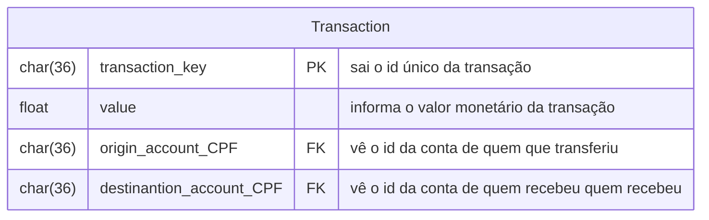

| Método | Caminho | O que faz | Entrada (campos que importam) | Saídas (status e quando) |
|---|---|---|---|---|
|`POST`|`transaction/`|Efetua uma transação de valor `value`|`value`, `origin_account_CPF`, `destination_account_CPF`|`201` com o `transaction_key`, `400` `QIT000001` corpo fora do formato,`422` `QIT001001` cpf do destinatário não está vinculado a uma conta cadastrada, `422` `QIT001008` valor de saldo insuficiente |
