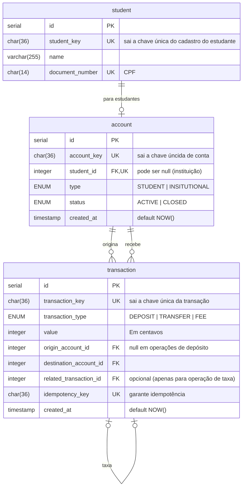

|Método|Caminho|O que faz|Entrada (campos que importam)|Saídas (status e quando)|
|---|---|---|---|---|
|`GET`|`/health_check`|Diz se o servidor está de pé|-|`204`|
|`POST`|`/student`|Cadastra estudante. Repetir não cria outro: `UNIQUE(document_number)`|`name`, `document_number`|`201` com `student_key`; `400` `QIT000001` corpo fora do formato; `409` `QIT001004` esse CPF já está cadastrado; `422` `QIT001003` CPF no formato válido, mas não está vinculado a nenhum estudante|
|`POST`|`/account`|Cria uma conta para estudante|`student_key`, `type`|`201` com `account_key` e `status` == `ACTIVE`; `400` `QIT000001` corpo fora do formato; `404` `QIT001001` cadastro do estudante não existe, `409` `QIT001009` estudante já possui conta|
|`POST`|`/deposit`|Depósito externo|`value`, `account_key`, `idempotency_key` no header|`201` com `transaction_key`, `400` `QIT000001` corpo fora do formato; `404` `QIT001001` conta do estudante não existe, `409` `QIT001010` `idempotency_key` utilizada em outra operação; `409` `QIT001011` a conta não pode receber (é institucional); `409` `QIT001002` conta em `CLOSED`|
|`POST`|`/transfer/`|Transferência de dinheiro|`value`, `origin_account_key`, `destination_account_key`, `idempotency_key` no header| `400` `QIT000001` corpo fora do formato; `404` `QIT001001` conta de origem ou de depósito não existe; `403` `QIT001008` saldo não suficiente para realizar transação; `409` `QIT001002` conta de origem/destino em `CLOSED`; `409` `QIT001012` a conta de origem não pode transferir (é institucional); `409` `QIT001008` o saldo não é o suficiente para `value` + tarifa; `409` `QIT001010` `idempotency_key` utilizada em outra operação; `409` `QIT001013` uma conta não pode se auto-transferir; `400` `QIT001001` saldo não pode ser negativo|
|`GET`|`/account/{account_key}`|Consulta as informações de uma conta|`account_key` no caminho|`200` com `account_key`, `type`, `status`, `balance` e `created_at`; `404` `QIT000404` conta inexistente|
|`GET`|`/account/{account_key}/transactions`|pega o extrato da conta|`account_key` no caminho; `page` (padrão 0); `limit` (padrão 10, 1-100)|`200` com `data`, `limit`, `page`, `is_last_page`; `400` `QIT000001` corpo fora do formato, `404` conta inexistente|

`data` tem `transaction_key, transaction_type, amount, origin_account_key, destination_account_key, created_at`

