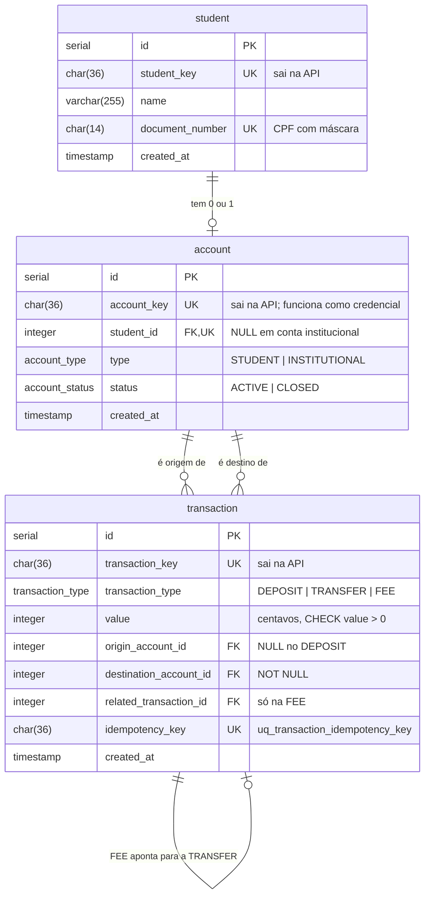
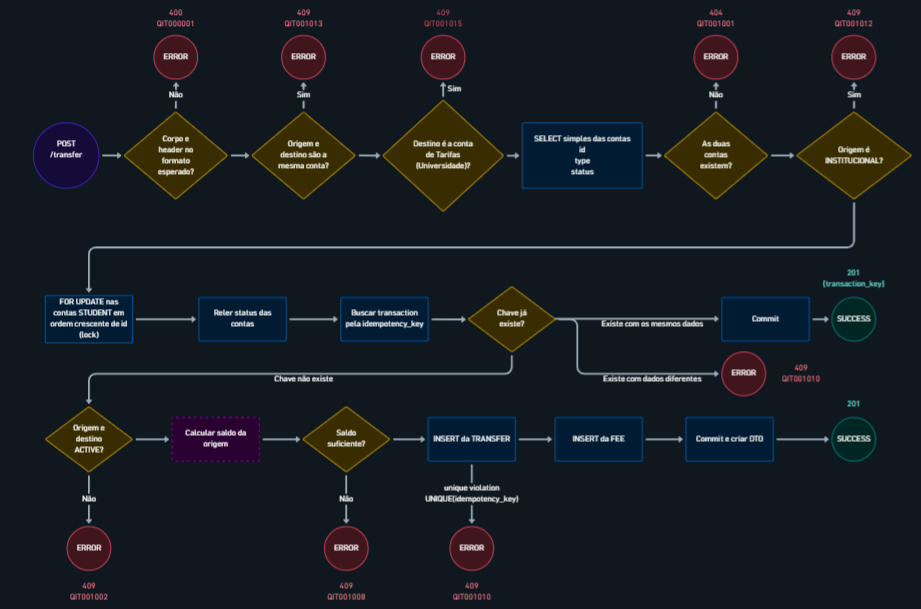
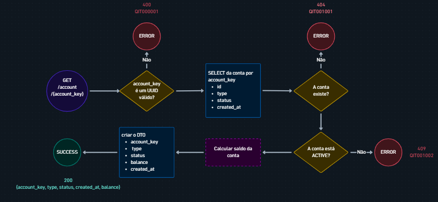
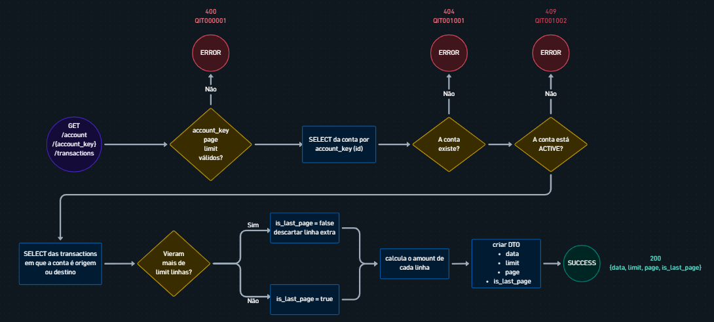
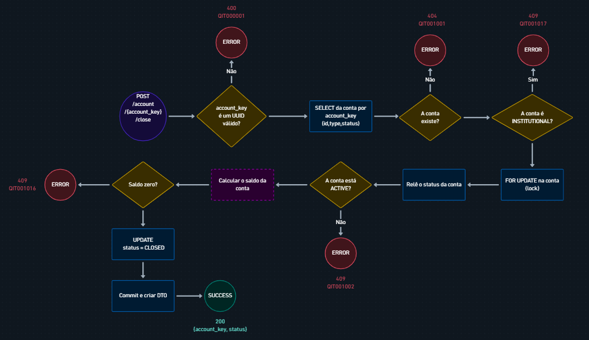

# RFC — Construção de um Sistema Bancário

| | |
|---|---|
| **Time** | Carlos Neto · Henrique Segala · Pedro Peixoto |
| **Data** | 28/09/2026 |
| **Versão** | 1.7 |

## Contextualização

### Entendendo o problema

O sistema bancário universitário tem como usuário o estudante. Ele pode se cadastrar, criar sua conta, depositar dinheiro para essa conta, transferir dinheiro sob-tarifa para outros(as) estudantes ou entidades do ecossistema universitário e consultar seu extrato. O sistema deve garantir o seguinte:

- Cadastro: o cadastro só pode ser efetuado por estudantes, os quais só pode se cadastrar uma única vez. Se falhar, passará a existir 2 cadastros iguais, o que poderá ocasionar um conflito nas transações.
- Transações: Uma transação só pode acontecer de forma única com o devido saldo. Se falhar, o cliente ficará com um saldo incoerente com os seus gastos
- Idempotência: Se 2 transações ocorrem ao mesmo tempo, o sistema deve efetuar primeiro uma, depois a outra. Se falhar, algum cliente terá um saldo incoerente
- Atomicidade: A operação deve ser concluída integralmente ou não produzir nenhuma alteração. Se falhar, poderá gerar "alterações parciais" que podem quebrar o banco de dados.
- Extrato: as informações de cada transação devem estar armazenadas para o usuário poder visualizar. Se falhar, o usuário não terá o extrato disponível

Fora do escopo da entrega: validação da origem externa dos depósitos, transação se originando nas contas institucionais e consulta do extrato por contas institucionais.

### Explicando a solução de forma macro

Três tabelas: `student`, `account` e `transaction`. O estudante é verificado junto ao servidor da universidade e só então gravado. Cada estudante tem no máximo uma conta `STUDENT`. As contas `INSTITUTIONAL` (universidade, cantina e estacionamento) são criadas por seed e só recebem dinheiro. Toda movimentação é uma linha em `transaction`, de um dos três tipos: `DEPOSIT`, `TRANSFER` ou `FEE`. O saldo não é armazenado: ele é calculado somando as linhas em que a conta é destino e subtraindo as linhas em que ela é origem. Cada transferência gera também uma `FEE` de R$ 2,00 para a conta da universidade, que funciona como conta de tarifas.

Concorrência e repetição são tratadas no banco: lock pessimista (`SELECT ... FOR UPDATE`) nas contas de estudante envolvidas, em ordem fixa de id, e uma chave de idempotência (`Idempotency-Key`) por operação, protegida por uma restrição `UNIQUE`.

- **Tabela separada de movimentações (`account_movement`)**: Todas informações que essa entidade representa podem ser facilmente colocado na própria entidade de transaction. A criação só traria maior complexidade. Seria útil caso outras “mecânicas” de transação fossem adicionadas (cashback, reembolso, pagamento parcelado…)
- **Guardar o saldo numa coluna da conta**: descartada porque o saldo pode divergir do histórico de transações, e cada movimentação teria que atualizar duas coisas. Ganharia em leitura muito frequente de saldo, com milhões de transações por conta.
- **Representar valores monetários com números de ponto flutuante (float)**: descartado porque erros de precisão podem comprometer cálculos financeiros. Seria mais adequado para valores aproximados, como medições científicas, e não para movimentações que exigem precisão monetária.
- **Separar contas de estudante e institucionais em tabelas diferentes**: descartado porque duplicaria a representação de conta e complicaria a relação com `transaction`, que precisa apontar para qualquer tipo de conta. Ganharia se as instituições fossem consideradas usuários ativos do sistema.
- **Usar CREATED como estado inicial da conta**: descartado porque, no nosso fluxo, a conta é criada e já fica disponível para uso; não existe um período em que a conta esteja criada, mas ainda não esteja ativa. Ganharia se houvesse diferentes "níveis de permissão" em uma conta

## Implementação

### Rotas

Todas as rotas, exceto `/` e `/health_check`, exigem o header **`INTERNAL-TOKEN`**, herdado do `base-service`. Sem ele, a resposta é `403 QIT000002`, antes de qualquer validação da rota. Ele **não é autenticação de estudante**: todos os clientes usam o mesmo valor.

Valores em **centavos**. `value` é inteiro, de 1 a **200.000.000** (R$ 2.000.000,00), por operação.

| Método | Caminho | O que faz | Entrada | Saídas | Idempotente? |
|---|---|---|---|---|---|
| `GET` | `/health_check` | Diz se o processo está de pé. Não consulta o banco | — | `204` | Sim (leitura) |
| `POST` | `/student` | Cadastra o estudante depois de a universidade confirmar o CPF | Corpo: `name` (1 a 255 caracteres), `document_number` (CPF com máscara `000.000.000-00`) | `201` com `student_key`; `400 QIT000001` corpo fora do formato; `422 QIT001003` a universidade diz que não é aluno; `503 QIT001014` universidade fora do ar, timeout ou resposta inesperada; `409 QIT001004` CPF já cadastrado | Não. Repetir dá `409` |
| `POST` | `/account` | Cria a conta do estudante. Sempre `STUDENT` e `ACTIVE` | Corpo: `student_key` (UUID) | `201` com `account_key` e `status`; `400 QIT000001` corpo fora do formato; `404 QIT001001` estudante não existe; `409 QIT001009` estudante já tem conta | Não. Repetir dá `409` |
| `POST` | `/deposit` | Deposita na conta de um estudante | Corpo: `account_key` (UUID), `value`. Header: `Idempotency-Key` (UUID) | `201` com `transaction_key`; `400 QIT000001` corpo ou header fora do formato; `404 QIT001001` conta não existe; `409 QIT001011` conta institucional; `409 QIT001002` conta `CLOSED`; `409 QIT001010` chave já usada em outra operação | **Sim**, pela `Idempotency-Key` |
| `POST` | `/transfer` | Transfere de um estudante para outro estudante ou para uma instituição, cobrando a tarifa | Corpo: `origin_account_key`, `destination_account_key` (UUIDs), `value`. Header: `Idempotency-Key` (UUID) | `201` com `transaction_key` da `TRANSFER`; `400 QIT000001` corpo ou header fora do formato; `409 QIT001013` origem e destino iguais; `409 QIT001015` destino é a conta de tarifas; `404 QIT001001` alguma conta não existe; `409 QIT001012` origem institucional; `409 QIT001002` origem ou destino `CLOSED`; `409 QIT001008` saldo menor que `value` + 200; `409 QIT001010` chave já usada em outra operação | **Sim**, pela `Idempotency-Key` |
| `GET` | `/account/{account_key}` | Conta com saldo calculado | `account_key` no caminho | **Não implementada** | — |
| `GET` | `/account/{account_key}/transactions` | Extrato paginado | Caminho: `account_key`. Query: `page` (≥ 0), `limit` (1 a 100) | **Não implementada** | — |

### Banco de Dados (Somente diagrama)

> *Só o diagrama. Entidades, chaves, relacionamentos e os campos que importam para o desafio: o que
> garante unicidade, o que guarda estado, o que registra quando aconteceu, o identificador que sai
> na resposta. **Sem prosa nesta seção** — se o principal desafio do seu desenho é o modelo de
> dados, o único texto aqui é o destaque "Principal desafio". Substitua o esqueleto abaixo pelo seu
> diagrama.*

**Restrições que sustentam as regras:**

| Restrição | Garante |
|---|---|
| `UNIQUE(document_number)` (`student_document_number_key`) | Um CPF, um cadastro. É a fonte do `409 QIT001004` |
| `UNIQUE(student_id)` (`account_student_id_key`) | Um estudante, uma conta. É a fonte do `409 QIT001009`. No Postgres, o `UNIQUE` aceita vários `NULL`, então várias contas institucionais convivem |
| `CHECK` em `account` | `STUDENT` sempre tem `student_id`; `INSTITUTIONAL` nunca tem |
| `UNIQUE(idempotency_key)` (`uq_transaction_idempotency_key`) | A mesma operação não é gravada duas vezes, nem sob concorrência. É a fonte do `409 QIT001010` |
| `CHECK (value > 0)` | Nenhuma movimentação zerada ou negativa |
| `destination_account_id NOT NULL` | Toda movimentação tem destino |
| Índices em `origin_account_id` e `destination_account_id` | Saldo e extrato, que filtram por essas colunas |

**Seed (contas institucionais, chaves fixas):**

| Conta | `account_key` | Papel |
|---|---|---|
| Universidade | `26ccf53d-7a91-41bf-acc2-09a93743f423` | **Conta de tarifas.** Só recebe `FEE`. Configurada pela variável `FEE_ACCOUNT_KEY` |
| Cantina | `06d8b86d-6d68-402d-9c8a-e089230f16ce` | Recebe transferências |
| Estacionamento | `e2f33a85-efb7-4bc5-afde-4ffe5229f7f3` | Recebe transferências |

### Fluxos

Link do Whimscal para melhor visualização: https://whimsical.com/bootcamp2/fluxos-Uq8pBwVatqN26ap3qpyKff

#### Fluxo de cadastro de estudante 

Cadastro - **caminho feliz**

1. O schema valida o corpo.
2. A API consulta `GET /student/{cpf}` no servidor da universidade, **antes** de tocar no banco e **fora** de qualquer transação, com timeout de 5 segundos (`UNIVERSITY_API_TIMEOUT`).
3. A universidade responde `200`.
4. A API gera a `student_key` (UUID) e faz o `INSERT`.
5. `COMMIT` e `201` com a `student_key`.

**Cadastro — falha: Estudante já cadastrado**
1. A universidade confirma o aluno.
2. O `INSERT` viola o `UNIQUE(document_number)`.
3. A API responde `409 QIT001004`. A consulta à universidade vem antes de propósito: quem não é aluno recebe `422`, e não descobre se um CPF está cadastrado.

#### Fluxo de criação de conta 

Criação de Conta - **caminho feliz**

1. O schema valida o corpo, inclusive o formato UUID da `student_key`.
2. A API busca o estudante pela `student_key`.
3. A API gera a `account_key` e faz o `INSERT` com `type = STUDENT` e `status = ACTIVE`.
4. `COMMIT` e `201` com `account_key` e `status`.

Criação de Conta — **falha: Estudante já cadastrado**

1. O `INSERT` viola o `UNIQUE(student_id)`.
2. A API responde `409 QIT001009`. A chave da conta existente **não** é devolvida, porque chave perdida não é recuperável nesta versão.

#### Fluxo de Depósito 

Depósito - **caminho feliz**

1. O schema valida o corpo, e o resource valida o header `Idempotency-Key` (presente e com formato UUID).
2. As chaves são convertidas para minúsculas.
3. A transação é aberta com isolamento `READ COMMITTED`.
4. A API busca a conta. Se ela não existir, a resposta é `404`. Se for institucional, `409 QIT001011`.
5. `SELECT ... FOR UPDATE` na conta. O `status` usado daqui em diante é o lido junto com o lock.
6. A API busca uma transação com a mesma `Idempotency-Key` e não encontra.
7. A conta não está `CLOSED`.
8. `INSERT` do `DEPOSIT`, sem origem e com destino na conta.
9. `COMMIT` e `201` com a `transaction_key`.

Depósito — **falha: API dá "retry"**

1. No passo 6, a API encontra uma transação com a mesma chave, do tipo `DEPOSIT`, com o mesmo `value` e na mesma conta.
2. `COMMIT` sem gravar nada e `201` com a `transaction_key` original.

#### Fluxo de Transferência 

Transferência - **caminho feliz**

1. O schema valida o corpo, e o resource valida o header `Idempotency-Key`.
2. As chaves são convertidas para minúsculas.
3. **Fora da transação:** se origem e destino forem iguais, a resposta é `409 QIT001013`. Se o destino for a conta de tarifas, `409 QIT001015`. As duas checagens só comparam valores da requisição.
4. A transação é aberta com isolamento `READ COMMITTED`.
5. Leitura simples (sem lock) da origem, do destino e da conta de tarifas, numa consulta só. Se a origem ou o destino não existirem, `404`. Se a conta de tarifas não existir, `500`, porque é um erro de configuração. Se a origem for institucional, `409 QIT001012`.
6. `SELECT ... FOR UPDATE` nas contas **de estudante** envolvidas, **em ordem crescente de `id`**. Contas institucionais não são travadas.
7. A API busca a `Idempotency-Key` e não encontra.
8. Nem a origem nem o destino estão `CLOSED`.
9. O saldo da origem, calculado depois do lock, é maior ou igual a `value` + 200.
10. `INSERT` da `TRANSFER`.
11. `INSERT` da `FEE`: 200 centavos, da origem para a universidade, com `related_transaction_id` igual ao `id` da `TRANSFER`.
12. `COMMIT` e `201` com a `transaction_key` da `TRANSFER`.

Transferência — **Falha: saldo insuficiente**

1. No passo 9, o saldo é menor que `value` + 200.
2. `409 QIT001008`. Nada é gravado, a chave não é consumida e os locks são soltos.

Transferência - **Falha: duas requisições com a mesma chave ao mesmo tempo, em contas diferentes**
1. Como o lock é por conta, uma requisição não espera a outra. As duas passam pelo passo 7 sem encontrar a chave.
2. A primeira grava a `TRANSFER`. O `INSERT` da segunda viola o `uq_transaction_idempotency_key`.
3. A API reconhece **essa** restrição e responde `409 QIT001010`. Qualquer outra violação vira `500`.

> ## Principal desafio
>
> - **Qual é:** garantir que o saldo nunca fique negativo e que nenhuma operação aconteça duas vezes, com várias requisições simultâneas sobre as mesmas contas.
> - **Por que é difícil:** a solução óbvia ("ler o saldo, conferir, gravar") quebra com duas transferências simultâneas da mesma conta. As duas leem o mesmo saldo, as duas aprovam, e o saldo fica negativo. Travar as contas resolve isso, mas criaria deadlock em transferências cruzadas (A→B e B→A ao mesmo tempo). E o lock por conta não protege a idempotência quando a mesma chave chega em contas diferentes.
> - **Como o desenho resolve:**
>   - `SELECT ... FOR UPDATE` nas contas de estudante **antes** de calcular o saldo. A segunda requisição espera a primeira terminar e já enxerga a transação dela. O isolamento `READ COMMITTED` garante que essa leitura vê o commit da outra.
>   - Locks **sempre em ordem crescente de `id`**, o que elimina o deadlock nas transferências cruzadas.
>   - A idempotência é checada **depois** do lock (o retry na mesma conta espera e encontra a transação original) e **antes** de `CLOSED` e do saldo (o retry devolve o original mesmo se a situação da conta mudou).
>   - O `UNIQUE` na `idempotency_key` cobre o único caso que o lock não serializa: a mesma chave em contas diferentes.
>   - `TRANSFER` e `FEE` no mesmo `COMMIT`: ou as duas existem, ou nenhuma.

#### Fluxo de Analisar uma Conta 

**Caminho feliz**
1. O resource valida a `account_key` do caminho (formato UUID).
2. A chave é convertida para minúsculas, e a API busca a conta.
3. A conta não está `CLOSED`.
4. A API calcula o saldo e responde `200`. É só leitura: sem lock e sem escrita.

**Falha: conta encerrada**
1. A conta existe, mas está `CLOSED`.
2. `409 QIT001002`. Nenhum dado da conta é devolvido.

O saldo devolvido é uma fotografia do instante e não serve como checagem antes de transferir. Quem decide se há saldo é o `/transfer`, com lock.

#### Fluxo de Analisar o Extrato

**Caminho feliz**
1. O decorator `validate_query_params` do `base-service` valida `page` e `limit` contra um JSON Schema, e o resource valida a `account_key`.
2. A API busca a conta (`404` se não existir, `409 QIT001002` se estiver `CLOSED`).
3. Uma consulta só traz as transações em que a conta é origem ou destino, já com o `amount` com sinal e com a outra ponta por `LEFT JOIN` em `account` e `student`, em `ORDER BY created_at DESC, id DESC`, com `LIMIT limit + 1` e `OFFSET page × limit`.
4. Se vieram mais de `limit` linhas, a extra é descartada e `is_last_page = false`. Senão, `is_last_page = true`.
5. O DTO monta cada linha: o nome só sai se a outra ponta for estudante, e a chave só sai se for instituição.
6. `200` com o envelope `data`, `limit`, `page` e `is_last_page`.

**Falha: página além da última**
1. O `OFFSET` passa do total de linhas.
2. `200` com `data` vazio e `is_last_page = true`. Não é erro.

O saldo devolvido é uma fotografia do instante e não serve como checagem antes de transferir. Quem decide se há saldo é o `/transfer`, com lock.

#### Fluxo de Fechar uma Conta

**Caminho feliz**
1. O resource valida a `account_key`.
2. A transação é aberta com isolamento `READ COMMITTED`.
3. A API busca a conta. Se não existir, `404`. Se for institucional, `409 QIT001017`. Essa checagem vem antes do lock, porque o `type` nunca muda.
4. `SELECT ... FOR UPDATE` na conta, o **mesmo lock** do `/deposit` e do `/transfer`.
5. A conta não está `CLOSED`.
6. O saldo, calculado **depois do lock**, é zero.
7. `UPDATE` do `status` para `CLOSED`, `COMMIT` e `200`.

**Falha: depósito e encerramento ao mesmo tempo**
1. As duas requisições disputam o lock da conta.
2. Se o encerramento trava primeiro, ele vê saldo zero e fecha. O depósito espera, lê o `status` atualizado junto com o lock e recebe `409 QIT001002`.
3. Se o depósito trava primeiro, ele grava. O encerramento espera, calcula o saldo depois do lock, vê o valor depositado e recebe `409 QIT001016`.
4. Em nenhuma ordem a conta termina fechada com dinheiro dentro.

